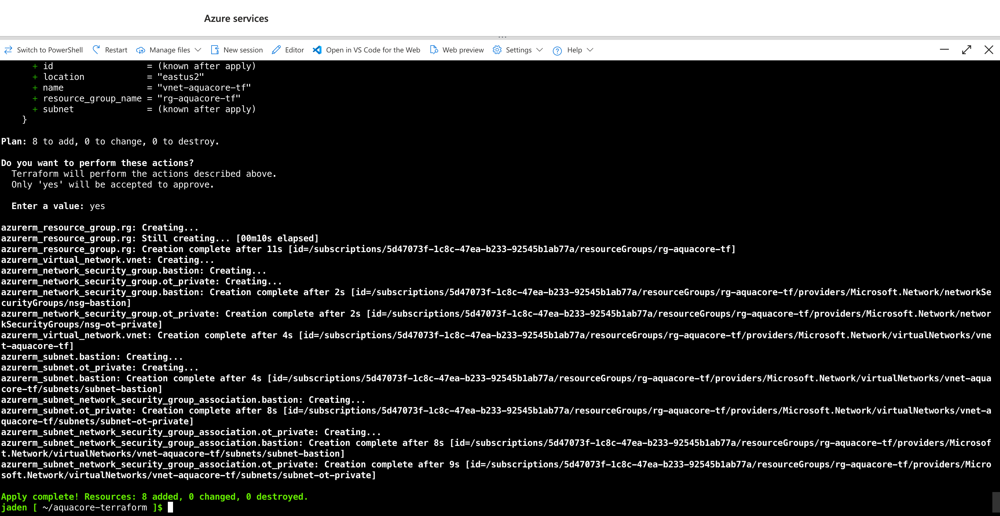
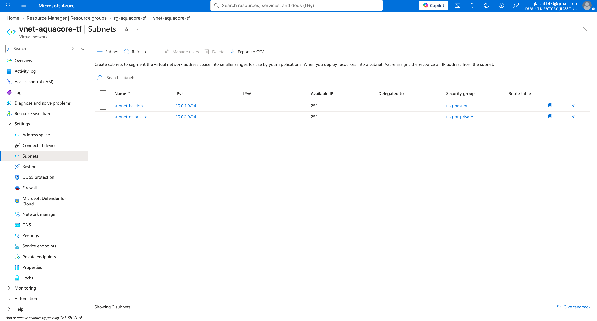
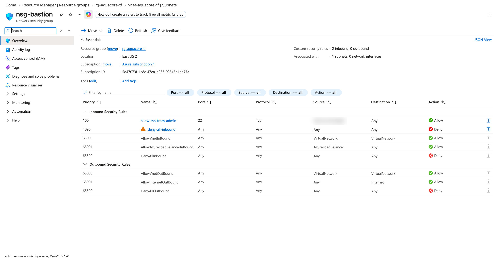
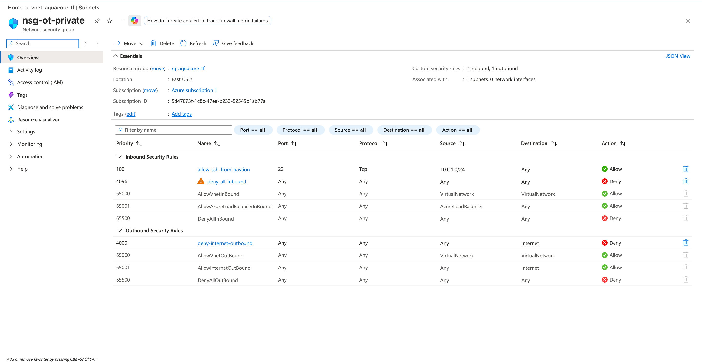
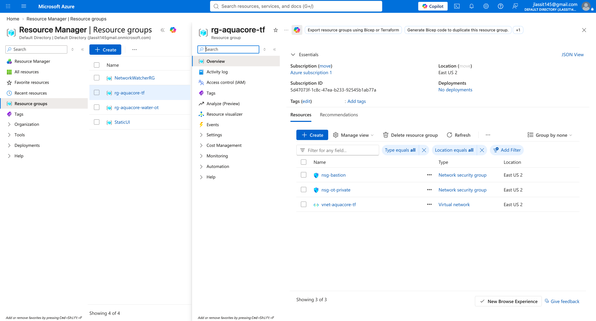

# Aqua Core Network in Terraform (with Checkov scan)

Week 4, project 2 of my Azure portfolio. I rebuilt a segmented network for a **fictional** water utility, Aqua Core, as Infrastructure as Code, then scanned it with Checkov to prove the security rules hold.

> **Scope note:** built in Azure Cloud Shell. Fictional scenario, not a production deployment. No VMs are attached yet, so this is the network layer only.

## Walkthrough

## Scenario

Aqua Core has an admin "bastion" subnet and a private OT (operational technology) subnet that runs water-treatment systems. Rules:

- Only my admin IP can SSH into the bastion subnet.
- Only the bastion subnet can SSH into the OT subnet.
- The OT subnet cannot reach the internet.
- Everything else inbound is denied.

## What was built (8 resources)

| Resource | Azure name | Notes |
|---|---|---|
| Resource group | `rg-aquacore-tf` | East US 2 |
| Virtual network | `vnet-aquacore-tf` | `10.0.0.0/16` |
| Subnet | `subnet-bastion` | `10.0.1.0/24` |
| Subnet | `subnet-ot-private` | `10.0.2.0/24` |
| NSG | `nsg-bastion` | allow SSH from admin IP (priority 100), deny all inbound (4096) |
| NSG | `nsg-ot-private` | allow SSH from bastion subnet (100), deny all inbound (4096), deny outbound to Internet (4000) |
| NSG association x2 | | each NSG attached to its subnet |

## Security design

- **My IP is never in the code.** The admin IP is a Terraform variable, passed at runtime with `TF_VAR_admin_ip_cidr`. Nothing real is committed.
- **The variable validates itself.** It must be a valid CIDR and cannot be `0.0.0.0/0`, so the whole internet can never be opened to SSH by mistake.
- **/32 means exactly one address**, so only my single IP is allowed.
- **Default deny.** Each NSG ends with an explicit deny-all-inbound rule.
- **OT is isolated.** Its only way in is from the bastion subnet, and it has no outbound internet.

## Workflow I ran

1. `terraform init` and `terraform validate`
2. Checkov scan of the secure code
3. Checkov scan of a deliberately broken copy (negative test)
4. `terraform plan`: 8 to add
5. `terraform apply`: 8 added
6. Verified every resource and rule in the Azure portal

## Checkov results

| Scan | Passed | Failed |
|---|---|---|
| Secure code | 12 | 0 |
| Broken copy (SSH source set to `*`) | 11 | 1 |

The failure on the broken copy was **CKV_AZURE_10** (SSH open to the internet) on `nsg-bastion`. This proves the scanner catches the exact mistake I care about, not just that my code passes.

## Evidence

Apply complete, 8 added:

Both subnets with their NSG attached:

Bastion NSG rules (my IP blurred):

OT NSG rules:

Everything in the resource group:

## Honest notes

- **Checkov cannot see the variable's value.** The admin IP is only known at runtime, so Checkov scans the code, not the value I pass in. The real guard against an open SSH rule is the variable validation. Checkov and validation cover different gaps.
- **Network layer only.** No VMs, flow logs, or diagnostic settings yet. A real build would add NSG flow logs and monitoring.
- **Deny outbound blocks updates.** The OT subnet cannot reach the internet, so patching would need a controlled path (a proxy or update server).
- **Local state only.** State sat in a local file. A team setup would use remote state with locking.
- **Cloud Shell is ephemeral.** I downloaded my files before cleanup so nothing was lost if the session reset.
- **Small mistakes along the way:** a typo in my `PATH` export left the shell at a `>` prompt (fixed with Ctrl+C), and Checkov printed a pip dependency warning that did not affect results.

## Files

- `main.tf`: network, subnets, NSGs, associations
- `variables.tf`: admin IP (validated) and location
- `.terraform.lock.hcl`: provider version lock (committed on purpose)
- `.gitignore`: keeps state, plugins and variable files out of Git
- `screenshots/`: evidence
